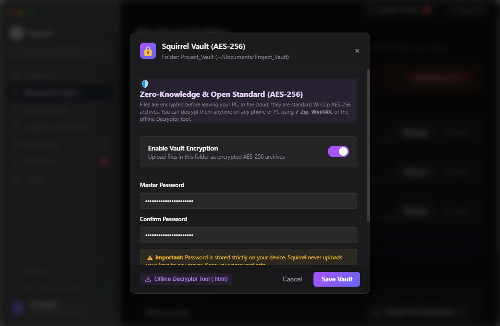
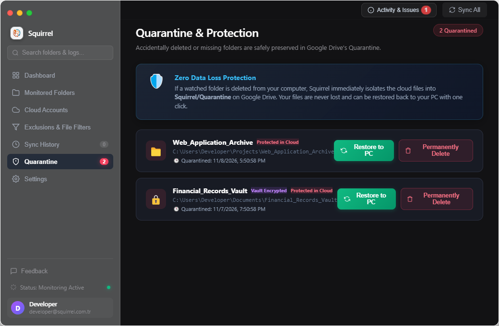
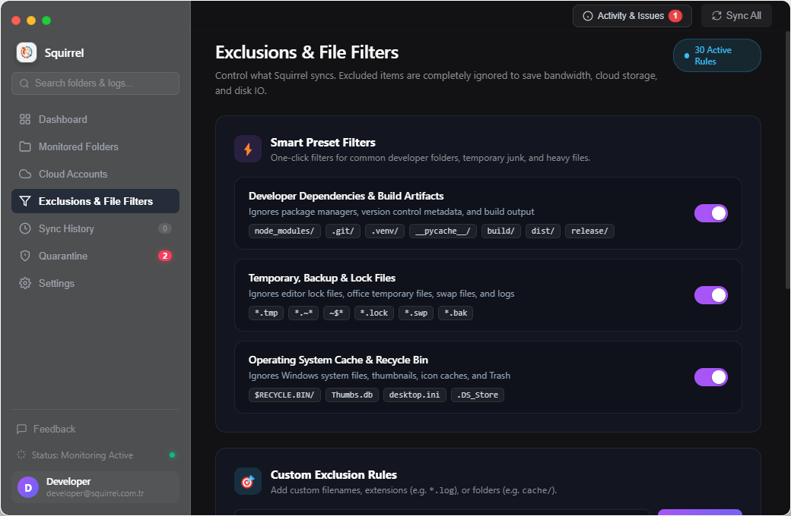
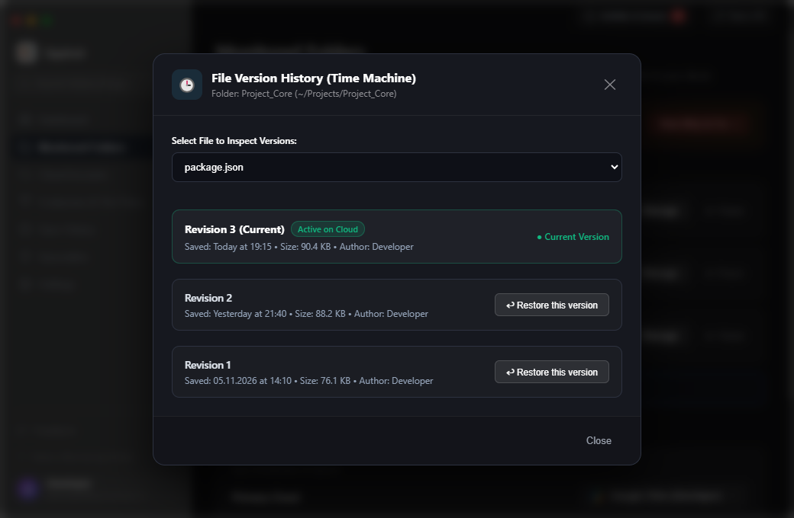
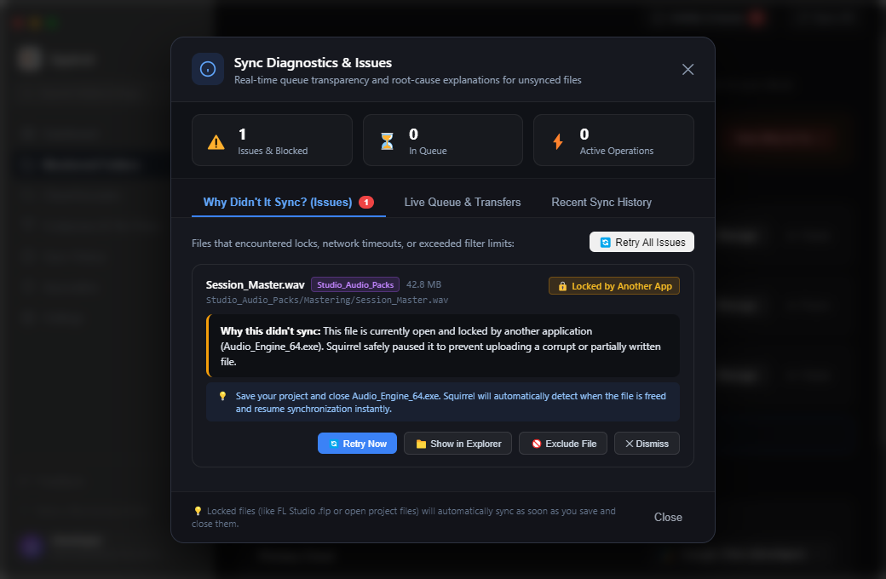

# Squirrel 🐿️

> **Fast, private, and intelligent cloud folder synchronization desktop client.**

Squirrel synchronizes your local folders with major cloud providers (**Google Drive**, **Microsoft OneDrive**, **Dropbox**, **MEGA**, and **iCloud Drive**) seamlessly in real-time.

Built with **Electron**, **Node.js**, and modern web technologies, Squirrel is lightweight, completely private, and free of telemetry.

---

## 🌟 Major Highlights & Flagship Features

### 1. 🔐 Squirrel Vault (Zero-Knowledge AES-256 Client-Side Encryption)
Keep your sensitive files completely private. When Vault is enabled for a monitored folder:
- **Client-Side Encryption:** Files are compressed and encrypted with military-grade **AES-256** directly on your computer before ever touching the network (`.sqvault.zip`).
- **Zero-Knowledge Architecture:** Cloud providers only store encrypted ciphertext. No keys, passwords, or filenames are ever exposed.
- **Standalone Offline Decryptor:** Export an offline HTML Decryptor tool (`Squirrel-Vault-Decryptor.html`) to open and extract your encrypted archives anywhere, on any device (Windows, Mac, Linux, mobile), with no Squirrel installation required.



---

### 2. 🛡️ Safe Quarantine & Deletion Protection
Accidentally deleting a folder or suffering a ransomware attack shouldn't destroy your cloud backup.
- **Automatic Cloud Isolation:** If a local monitored folder is deleted or goes missing, Squirrel instantly isolates its cloud files into a safe **Quarantine** area rather than permanently trashing them.
- **1-Click Restoration:** Review quarantined folders directly from the dedicated **Quarantine** tab and restore them back to their original local disk paths with a single click.
- **Permanent Purge Option:** When you are certain a deletion was intentional, permanently clean up the cloud storage with one click.



---

### 3. 🎯 Advanced Exclusions & File Filters
Save cloud bandwidth, avoid quota limits, and eliminate disk bottlenecks by keeping unnecessary junk out of your cloud storage.
- **Smart 1-Click Presets:**
  - **Developer Dependencies & Build Artifacts:** `node_modules/`, `.git/`, `.venv/`, `__pycache__/`, `build/`, `dist/`, `release/`, `target/`, etc.
  - **Temporary, Backup & Lock Files:** `*.tmp`, `*.~*`, `~$*`, `*.lock`, `*.swp`, `*.bak`.
  - **Operating System Cache & Recycle Bin:** `$RECYCLE.BIN/`, `Thumbs.db`, `desktop.ini`, `.DS_Store`.
- **Custom Patterns & Quick Chips:** Define custom glob rules, extensions, or folder names with quick add chips (`*.log`, `cache/`, `*.exe`, `.env`).
- **Max File Size Limit:** Set an automatic file size threshold (e.g. skip files larger than 100 MB or 500 MB).
- **Live Simulator:** Test any file path in real-time to preview whether it will be backed up or excluded.



---

### 4. ⏳ Time Machine (File Version History & Cloud Rollback)
Never lose progress when a project file gets accidentally overwritten, saved over, or corrupted.
- **Chronological Cloud Revisions:** Inspect historical versions of individual files saved on Google Drive.
- **Version Metadata:** View saved dates, file sizes, and author details for every revision.
- **1-Click Rollback:** Restore any historical revision directly to your local disk with a single click.



---

### 5. 🩺 Sync Diagnostics & Issues Inspector ("Why Didn't It Sync?")
End the frustration of mystery sync failures with complete transparency and automated recovery.
- **Human-Readable Explanations:** Plain-English root causes instead of cryptic network or API error codes.
- **Locked File Detection:** Instantly detects files currently held open and locked by creative software (e.g., FL Studio `.flp`, Ableton, Photoshop, video editing timelines).
- **Auto-Resume on Close:** Squirrel pauses locked files safely to prevent partial data corruption and automatically resumes synchronization the moment the file is saved and closed in the external application.
- **Retry Controls:** Manual retry buttons, auto-retry countdown timers, and issue dismissal tools.



---

## 🚀 Additional Capabilities

- **Multi-Cloud Support**: Connect and manage Google Drive, Microsoft OneDrive, Dropbox, MEGA, and iCloud Drive. Choose your primary cloud target anytime from the toolbar.
- **Real-Time File Watcher**: Instant detection of file creations, modifications, and deletions.
- **Bandwidth & CPU Profiles**:
  - 🏎️ **High Speed (Turbo)**: Maximum bandwidth usage with parallel transfers for high-speed multi-file backups.
  - 🧠 **Smart (Low CPU)**: Throttled intervals between operations, keeping CPU usage minimal (< 0.5%) even during intensive workflows.
  - 🔋 **Battery Saver (Eco)**: Energy-efficient sync for extended laptop battery life.
- **Two-Way Offline Reconciliation**: Compares local and remote manifests on startup and handles offline modifications cleanly.
- **Zero Telemetry**: All tokens, credentials, and sync metadata stay strictly on your local machine.

---

## 🛠️ Getting Started

### Prerequisites

- [Node.js](https://nodejs.org/) (version 18 or higher recommended)
- [npm](https://www.npmjs.com/)

### Installation

1. Clone or download the repository:
   ```bash
   git clone https://github.com/ArdaGl1/Squirrel.git
   cd Squirrel
   ```

2. Install dependencies:
   ```bash
   npm install
   ```

3. Launch Squirrel:
   ```bash
   npm start
   ```

### Building Executables

- Create Windows Installer (NSIS):
  ```bash
  npm run build:installer
  ```
- Create Windows Portable (`.exe`):
  ```bash
  npm run build:portable
  ```

---

## 🔑 Cloud Authentication Setup

### Google Drive
1. Click **Cloud Accounts** in the Squirrel sidebar.
2. Under **Google Drive**, click **Sign In with Google**.
3. A browser window opens. Authenticate with your Google account and grant the requested scope (`drive.file`).
4. Squirrel only creates and manages files inside its own `Squirrel` folder on your Drive.

> **For Developers:** If you wish to use your own Google Cloud OAuth Client ID, expand the *Advanced: Developer Credentials* section and select your custom `credentials.json` file.

### Other Providers
- **Microsoft OneDrive**: Sign in with your Microsoft account via OAuth.
- **Dropbox**: Connect using standard Dropbox app tokens or OAuth.
- **MEGA**: Authenticate securely using your email and password via end-to-end encryption.
- **iCloud Drive**: Connect to your local iCloud Drive storage path.

---

## 🔒 Privacy & Permissions

Squirrel requests minimal required scopes. Specifically for Google Drive, it only requests:
`https://www.googleapis.com/auth/drive.file`

This means Squirrel **CANNOT** access, view, or touch any files outside of the ones it creates for you. Read our full [Privacy Policy](PRIVACY.md) for details.

---

## 📄 License

This project is licensed under the MIT License — see the [LICENSE](LICENSE) file for details.
